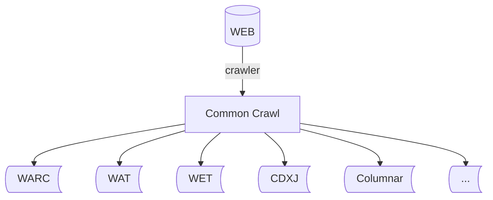
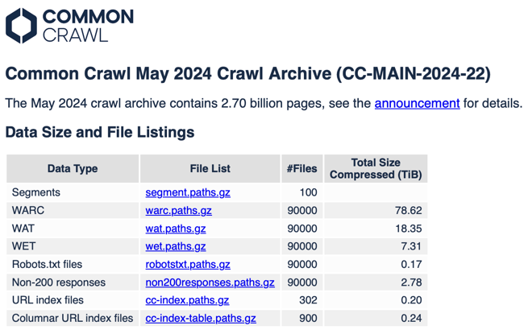
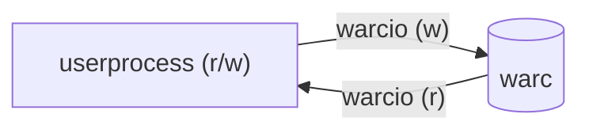

# Whirlwind Tour of Common Crawl's Datasets using Java

The Common Crawl corpus contains petabytes of crawl data, including raw web page data, metadata, and parsed text. Common Crawl's data storage is a little complicated, as you might expect for such a large and rich dataset. We make our crawl data available in a variety of formats (WARC, WET, WAT) and we also have two index files of the crawled webpages: CDXJ and columnar.


The goal of this whirlwind tour is to show you how a single webpage appears in all of these different places. That webpage is [https://an.wikipedia.org/wiki/Escopete](https://an.wikipedia.org/wiki/Escopete), which we crawled on the date 2024-05-18T01:58:10Z. On the way, we'll also explore the file formats we use and learn about some useful tools for interacting with our data!

In the Whirlwind Tour, we will:
1) explore the WARC, WET and WAT file formats used to store Common Crawl's data.
2) play with some useful Java libraries for interacting with the data: [jwarc](https://github.com/iipc/jwarc), TBA if needed
and [duckdb](https://duckdb.org/).
3) learn about how the data is compressed to allow random access.
4) use the CDXJ index and the columnar index to access the data we want.

**Prerequisites:** To get the most out of this tour, you should be comfortable with Maven, running commands on the command line, and basic SQL. Some knowledge of HTTP requests and HTML is also helpful but not essential. We assume you have [make](https://www.gnu.org/software/make/) and [Maven](https://maven.apache.org/) installed.

We use a [Makefile](https://makefiletutorial.com) to provide many of the commands needed to run this tutorial. To see what commands are being run, open the `Makefile` and find the relevant target: e.g. `make install` runs `mvn clean install`.

~~Alternatively, a [notebook version](https://github.com/commoncrawl/whirlwind-python-notebook) of this tutorial is also available.~~

Let's get started!

## Task 0: Set-up

This tutorial was written on Linux and MacOS and it should also work on Windows. If you encounter any problems, please raise an issue.

### Clone the repository and create a local Python environment

First, [clone this repository](https://docs.github.com/en/repositories/creating-and-managing-repositories/cloning-a-repository) to create a local copy, then navigate to the `whirlwind-python` directory on your computer.

In general, it's a good idea to set up separate virtual environments (venvs) for Python projects. This lets you install packages without changing either the system Python environment or any of your other Python projects. 

If you already have your own favorite venv scheme, you can skip this step (we used the [Pycharm IDE](https://www.jetbrains.com/pycharm) to manage environment creation). Otherwise, you can create a venv on the command line by running:

```make venv```

After you create this venv, you'll need to activate it:

```source ~/venv/whirlwind/bin/activate```

On many systems, you will now see the name of the venv in parentheses before the command prompt. You'll need to activate the environment again if you log out and log in again.  

Next, let's install the necessary software for this tour:

```make install```

This command will print out a screen-full of output and install the Python packages in `requirements.txt` to your venv.

### Install and configure AWS-CLI

We will use the AWS Command Line Interface (CLI) later in the tour to access the data stored in Common Crawl's S3 bucket. Instructions on how to install the AWS-CLI and configure your account are available on the [AWS website](https://docs.aws.amazon.com/cli/latest/userguide/getting-started-install.html). 

## Task 1: Look at the crawl data

Common Crawl's website includes a [Get Started](https://commoncrawl.org/get-started) guide which summarises different ways to access the data and the file formats. We can use the dropdown menu to access the links for downloading crawls over HTTP(S):


If we click on `CC-MAIN-2024-22' in the dropdown, we are taken to a page listing the files contained in this crawl: 



In this whirlwind tour, we're going to look at the WARC, WET, and WAT files: the data types which store the crawl data. Later, we will look at the two index files and how these help us access the crawl data we want. At the [end of the Tour](#other-datasets), we'll mention some of Common Crawl's other datasets and where you can find more information about them.

### WARC

[WARC files](https://iipc.github.io/warc-specifications/specifications/warc-format/warc-1.0/) are a container that holds files, similar to zip and tar files. It's the standard data format used by archiving
community and we use it to store raw crawl data. As you can see in the file listing above, our WARC files are very large even when compressed! Luckily, we have a much smaller example to look at. 

Open `whirlwind.warc` in your favorite text editor. Note that this is an uncompressed version of the file; normally we always work with these files while they are compressed. This is the WARC corresponding to the single webpage we mentioned in the introduction.

You'll see four records total, with the start of each record marked with the header `WARC/1.0` followed by metadata related to that particular record. The `WARC-Type` field tells you the type of each record. In our WARC file, we have:
1) a `warcinfo` record. Every WARC has that at the start. 
2) the `request` to the webserver, with its HTTP headers.
3) the `response` from the webserver, with its HTTP headers followed by the html.
4) a `metadata` record related to the HTTP response.

### WET

WET (WARC Encapsulated Text) files only contain the body text of web pages parsed from the HTML and exclude any HTML code, images, or other media. This makes them useful for text analysis and natural language processing (NLP) tasks.

Open `whirlwind.warc.wet`: this is the WET derived from our original WARC. We can see that it's still in WARC format with two records: 
1) a `warcinfo` record.
2) a `conversion` record: the parsed text with HTTP headers removed.

### WAT

WAT (Web ARChive Timestamp) files contain metadata associated with the crawled web pages (e.g. parsed data from the HTTP response headers, links recovered from HTML pages, server response codes etc.). They are useful for analysis that requires understanding the structure of the web.

Open `whirlwind.warc.wat`: this is the WAT derived from our original WARC. Like the WET file, it's also in WARC format. It contains two records:
1) a `warcinfo` record.
2) a `metadata` record: there should be one for each response in the WARC. The metadata is stored as JSON. 

You might want to feed the JSON into a pretty-printer to read it more easily. For example, you can save just the JSON into a file and use `python -m json.tool FILENAME` to pretty-print it.

Now that we've looked at the uncompressed versions of these files to understand their structure, we'll be interacting with compressed WARC, WET, and WAT files for the rest of this tour. This is the usual way we manipulate this data with software tools due to the size of the files.

## Task 2: Iterate over WARC, WET, and WAT files

The [warcio](https://github.com/webrecorder/warcio) Python library lets us read and write WARC files programmatically.

Let's use it to iterate over our WARC, WET, and WAT files and print out the record types we looked at before. First, look at the code in `org.commoncrawl.whirlwind.ReadWARC`:

<details>
  <summary>Click to view code</summary>

```java
package org.commoncrawl.whirlwind;

import org.netpreserve.jwarc.MessageHeaders;
import org.netpreserve.jwarc.WarcReader;

import java.io.DataInputStream;
import java.io.IOException;
import java.nio.file.Files;
import java.nio.file.Path;
import java.util.Arrays;
import java.util.List;
import java.util.zip.GZIPInputStream;

public class ReadWARC {

    public static void main(String[] args) throws IOException {

        if (args.length != 1) {
            System.err.println("Usage: java ReadWARC <input-warc-file>");
            System.exit(1);
        }

        Path requested = Path.of(args[0]).toAbsolutePath().normalize();
        if (!Files.isRegularFile(requested)) {
            throw new SecurityException("Invalid WARC path");
        }

        final List<String> RESPONSE_TYPES = Arrays.asList("request", "response", "conversion", "metadata");
        try (
                GZIPInputStream gzInputStream = new GZIPInputStream(Files.newInputStream(requested));
                DataInputStream inStream = new DataInputStream(gzInputStream)
        ) {
            WarcReader reader = new WarcReader(inStream);

            reader.records()
                    .forEach(record -> {
                        System.out.println(" WARC-Type: " + record.type());
                        if (RESPONSE_TYPES.contains(record.type())) {
                            MessageHeaders headers = record.headers();
                            for (String header : headers.all("WARC-Target-URI")) {
                                System.out.println(" WARC-Target-URI " + header);
                            }
                        }
                    });
        }
    }
}

```
</details>

The `WarcReader` reads the WARC content using Streams in a single pass and allows us to access the attributes of each record (e.g. the record type through `record.rec_type`).

Now run: 

`make iterate` 

This will run `org.commoncrawl.whirlwind.ReadWARC` on `whirlwind.warc.gz`, `whirlwind.warc.wet.gz`, and `whirlwind.warc.wat.gz` in turn. You should see output like the following:

<details>
  <summary>Click to view output</summary>

```
iterating over all of the local warcs:

warc:
mvn -q exec:java -Dexec.mainClass=org.commoncrawl.whirlwind.ReadWARC -Dexec.args="whirlwind.warc.gz"
 WARC-Type: warcinfo
 WARC-Type: request
 WARC-Target-URI https://an.wikipedia.org/wiki/Escopete
 WARC-Type: response
 WARC-Target-URI https://an.wikipedia.org/wiki/Escopete
 WARC-Type: metadata
 WARC-Target-URI https://an.wikipedia.org/wiki/Escopete

wet:
mvn -q exec:java -Dexec.mainClass=org.commoncrawl.whirlwind.ReadWARC -Dexec.args="whirlwind.warc.wet.gz"
 WARC-Type: warcinfo
 WARC-Type: conversion
 WARC-Target-URI https://an.wikipedia.org/wiki/Escopete

wat:
mvn -q exec:java -Dexec.mainClass=org.commoncrawl.whirlwind.ReadWARC -Dexec.args="whirlwind.warc.wat.gz"
 WARC-Type: warcinfo
 WARC-Type: metadata
 WARC-Target-URI https://an.wikipedia.org/wiki/Escopete
```
</details>

The output has three sections, one each for the WARC, WET, and WAT. For each one, it prints the record types we saw before, plus the `WARC-Target-URI` for those record types that have it.

