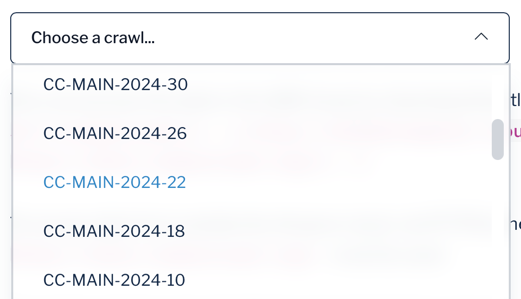
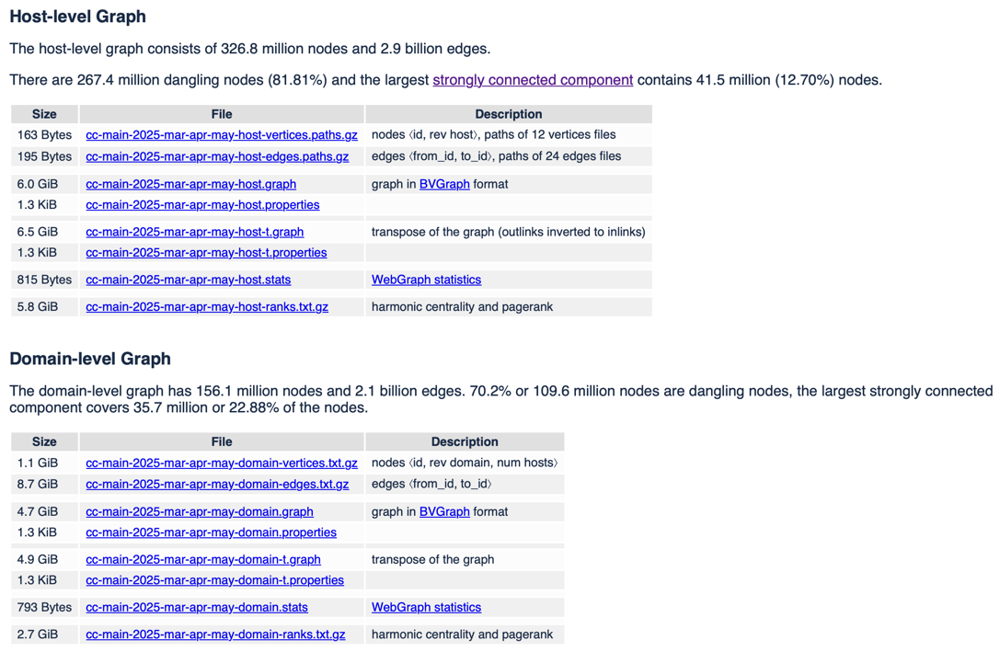

# Whirlwind Tour of Common Crawl's Datasets using Java

The Common Crawl corpus contains petabytes of crawl data, including raw web page data, metadata, and parsed text. Common Crawl's data storage is a little complicated, as you might expect for such a large and rich dataset. We make our crawl data available in a variety of formats (WARC, WET, WAT) and we also have two index files of the crawled webpages: CDXJ and columnar.


The goal of this whirlwind tour is to show you how a single webpage appears in all of these different places. That webpage is [https://an.wikipedia.org/wiki/Escopete](https://an.wikipedia.org/wiki/Escopete), which we crawled on the date 2024-05-18T01:58:10Z. On the way, we'll also explore the file formats we use and learn about some useful tools for interacting with our data!

In the Whirlwind Tour, we will:
1) explore the WARC, WET and WAT file formats used to store Common Crawl's data.
2) play with some useful Java libraries for interacting with the data: [jwarc](https://github.com/iipc/jwarc), TBA if needed
and [duckdb](https://duckdb.org/).
3) learn about how the data is compressed in an unusual way to allow random access.
4) use the CDXJ index and the columnar index to access the data we want.

**Prerequisites:** To get the most out of this tour, you should be comfortable with Maven, running commands on the command line, and basic SQL. Some knowledge of HTTP requests and HTML is also helpful but not essential. We assume you have [make](https://www.gnu.org/software/make/) and [Maven](https://maven.apache.org/) installed.

We use a [Makefile](https://makefiletutorial.com) to provide many of the commands needed to run this tutorial. To see what commands are being run, open the `Makefile` and find the relevant target: e.g. `make build` is running `mvn clean package`.

Let's get started!

## Task 0: Set-up

This tutorial was written on Linux and MacOS and it should also work on Windows. If you encounter any problems, please raise an issue.

### Clone the repository

First, [clone this repository](https://docs.github.com/en/repositories/creating-and-managing-repositories/cloning-a-repository) to create a local copy, then navigate to the `whirlwind-java` directory on your computer.

Next, Maven usually takes care of downloading the JARs of all libraries when need, so you don't need to run anything beforehand. 

### Install and configure AWS-CLI

We will use the AWS Command Line Interface (CLI) later in the tour to access the data stored in Common Crawl's S3 bucket. Instructions on how to install the AWS-CLI and configure your account are available on the [AWS website](https://docs.aws.amazon.com/cli/latest/userguide/getting-started-install.html). 

## Task 1: Look at the crawl data

Common Crawl's website includes a [Get Started](https://commoncrawl.org/get-started) guide which summarises different ways to access the data and the file formats. We can use the dropdown menu to access the links for downloading crawls over HTTP(S):



If we click on `CC-MAIN-2024-22' in the dropdown, we are taken to a page listing the files contained in this crawl: 


In this whirlwind tour, we're going to look at the WARC, WET, and WAT files: the data types which store the crawl data. Later, we will look at the two index files and how these help us access the crawl data we want. At the [end of the Tour](#other-datasets), we'll mention some of Common Crawl's other datasets and where you can find more information about them.

### WARC

[WARC files](https://iipc.github.io/warc-specifications/specifications/warc-format/warc-1.0/) are a container that holds files, similar to zip and tar files. It's the standard data format used by archiving
community, and we use it to store raw crawl data. As you can see in the file listing above, our WARC files are very large even when compressed! Luckily, we have a much smaller example to look at. 

Open `whirlwind.warc` in your favorite text editor. Note that this is an uncompressed version of the file; normally we always work with these files while they are compressed. This is the WARC corresponding to the single webpage we mentioned in the introduction.

You'll see four records total, with the start of each record marked with the header `WARC/1.0` followed by metadata related to that particular record. The `WARC-Type` field tells you the type of each record. In our WARC file, we have:
1) a `warcinfo` record. Every WARC has that at the start. 
2) the `request` to the webserver, with its HTTP headers.
3) the `response` from the webserver, with its HTTP headers followed by the html.
4) a `metadata` record related to the HTTP response.

### WET

WET (WARC Encapsulated Text) files only contain the body text of web pages parsed from the HTML and exclude any HTML code, images, or other media. This makes them useful for text analysis and natural language processing (NLP) tasks.

Open `whirlwind.warc.wet`: this is the WET derived from our original WARC. We can see that it's still in WARC format with two records: 
1) a `warcinfo` record.
2) a `conversion` record: the parsed text with HTTP headers removed.

### WAT

WAT (Web ARChive Timestamp) files contain metadata associated with the crawled web pages (e.g. parsed data from the HTTP response headers, links recovered from HTML pages, server response codes etc.). They are useful for analysis that requires understanding the structure of the web.

Open `whirlwind.warc.wat`: this is the WAT derived from our original WARC. Like the WET file, it's also in WARC format. It contains two records:
1) a `warcinfo` record.
2) a `metadata` record: there should be one for each response in the WARC. The metadata is stored as JSON. 

You might want to feed the JSON into a pretty-printer to read it more easily. For example, you can save just the JSON into a file and use `python -m json.tool FILENAME` to pretty-print it.

Now that we've looked at the uncompressed versions of these files to understand their structure, we'll be interacting with compressed WARC, WET, and WAT files for the rest of this tour. This is the usual way we manipulate this data with software tools due to the size of the files.

## Task 2: Iterate over WARC, WET, and WAT files

The [JWarc](https://github.com/iipc/jwarc) Java library lets us read and write WARC files both programmatically and via a CLI.

You should download the [JWarc](https://github.com/iipc/jwarc)'s JAR using `make get_jwarc` which should download the JAR in the root directory. 
If you download it yourself, we recommend you to rename it to remove the version from the jar filename, so you can copy-paste the commands directly.
You can now explore the CLI commands available by running:

```shell
java -jar jwarc.jar --help
```

<details>
  <summary>Click to view the result</summary>

```
usage: jwarc <command> [args]...

Commands:

  cdx         List records in CDX format
  cdxj        List records in CDXJ format
  dedupe      Deduplicate records by looking up a CDX server
  extract     Extract record by offset
  fetch       Download a URL recording the request and response
  filter      Copy records that match a given filter expression
  ls          List records in WARC file(s)
  record      Fetch a page and subresources using headless Chrome
  recorder    Run a recording proxy
  saveback    Saves wayback-style replayed pages as WARC records
  screenshot  Take a screenshot of each page in the given WARCs
  serve       Serve WARC files with a basic replay server/proxy
  stats       Print statistics about WARC and CDX files
  validate    Validate WARC or ARC files
  version     Print version information
```

</details>

Let's iterate over our WARC, WET, and WAT files and print out the record types we looked at before. We will see the use of `ls` for listing records and offsets, and `extract` for pulling out records information (payload, headers) using the offsets as reference. ~~First, look at the code in `org.commoncrawl.whirlwind.ReadWARC`~~:

```shell
java -jar jwarc.jar ls data/whirlwind.warc.gz
         0 warcinfo   -    -
       516 request    GET  https://an.wikipedia.org/wiki/Escopete
      1023 response   200  https://an.wikipedia.org/wiki/Escopete
     18374 metadata   -    https://an.wikipedia.org/wiki/Escopete
```

The `java -jar jwarc.jar ls` command lists the records in a WARC file, showing the offset, type, HTTP status code (if applicable), and target URI for each record.

You can then extract information about the response record:
```shell
java -jar jwarc.jar extract data/whirlwind.warc.gz 1023
```

This command will return the full record: headers and payload. Is possible to select either by passing the `--payload` or `--headers` parameters before the filename. 

```shell
java -jar jwarc.jar extract --headers data/whirlwind.warc.gz 1023
```
<details>
  <summary>Click to view the result</summary>

```
WARC/1.0
Content-Length: 74581
Content-Type: application/http; msgtype=response
WARC-Block-Digest: sha1:35FTUGFVNWRVTZQGCWIX2MQA3LMYC7X7
WARC-Concurrent-To: <urn:uuid:292f457d-203c-42f2-a1b5-69a4dabefd4f>
WARC-Date: 2024-05-18T01:58:10Z
WARC-Identified-Payload-Type: text/html
WARC-IP-Address: 208.80.154.224
WARC-Payload-Digest: sha1:RY7PLBUFQNI2FFV5FTUQK72W6SNPXLQU
WARC-Record-ID: <urn:uuid:2aabeff2-67f5-4608-8466-e87c6296e2b6>
WARC-Target-URI: https://an.wikipedia.org/wiki/Escopete
WARC-Type: response
WARC-Warcinfo-ID: <urn:uuid:668d88fc-4208-41fc-b327-1aa6cb783331>

HTTP/1.1 200 OK
date: Sat, 18 May 2024 01:58:10 GMT
server: mw-web.eqiad.canary-bb67b76b8-jtwdb
x-content-type-options: nosniff
content-language: an
origin-trial: AonOP4SwCrqpb0nhZbg554z9iJimP3DxUDB8V4yu9fyyepauGKD0NXqTknWi4gnuDfMG6hNb7TDUDTsl0mDw9gIAAABmeyJvcmlnaW4iOiJodHRwczovL3dpa2lwZWRpYS5vcmc6NDQzIiwiZmVhdHVyZSI6IlRvcExldmVsVHBjZCIsImV4cGlyeSI6MTczNTM0Mzk5OSwiaXNTdWJkb21haW4iOnRydWV9
accept-ch: 
vary: Accept-Encoding,Cookie,Authorization
last-modified: Sat, 04 May 2024 01:58:10 GMT
content-type: text/html; charset=UTF-8
X-Crawler-content-encoding: gzip
age: 0
x-cache: cp1106 miss, cp1106 miss
x-cache-status: miss
server-timing: cache;desc="miss", host;desc="cp1106"
strict-transport-security: max-age=106384710; includeSubDomains; preload
report-to: { "group": "wm_nel", "max_age": 604800, "endpoints": [{ "url": "https://intake-logging.wikimedia.org/v1/events?stream=w3c.reportingapi.network_error&schema_uri=/w3c/reportingapi/network_error/1.0.0" }] }
nel: { "report_to": "wm_nel", "max_age": 604800, "failure_fraction": 0.05, "success_fraction": 0.0}
set-cookie: WMF-Last-Access=18-May-2024;Path=/;HttpOnly;secure;Expires=Wed, 19 Jun 2024 00:00:00 GMT
set-cookie: WMF-Last-Access-Global=18-May-2024;Path=/;Domain=.wikipedia.org;HttpOnly;secure;Expires=Wed, 19 Jun 2024 00:00:00 GMT
set-cookie: WMF-DP=1a6;Path=/;HttpOnly;secure;Expires=Sat, 18 May 2024 00:00:00 GMT
x-client-ip: 34.239.158.223
cache-control: private, s-maxage=0, max-age=0, must-revalidate
set-cookie: GeoIP=US:VA:Ashburn:39.05:-77.49:v4; Path=/; secure; Domain=.wikipedia.org
set-cookie: NetworkProbeLimit=0.001;Path=/;Secure;Max-Age=3600
accept-ranges: bytes
X-Crawler-transfer-encoding: chunked
Content-Length: 72848
```
</details>

Now, let's have a look at the WET and WAT compressed files.  
You can obtain similar information by running `ls` on those files: 
```shell
java -jar jwarc.jar ls data/whirlwind.warc.wet.gz 
         0 warcinfo   -    -
       466 conversion -    https://an.wikipedia.org/wiki/Escopete
```

and 

```shell
java -jar jwarc.jar ls data/whirlwind.warc.wat.gz 
         0 warcinfo   -    -
       443 metadata   -    https://an.wikipedia.org/wiki/Escopete
```

Following the same principle, you can obtain the converted text payload by running: 

```shell
java -jar jwarc.jar extract --payload data/whirlwind.warc.wet.gz
```

<details>
  <summary>Click to view the result</summary>

```
Escopete - Biquipedia, a enciclopedia libre
Ir al contenido
Menú principal
Menú principal
mover a la barra lateral
ocultar
Navego
Portalada
A tabierna
Actualidat
Zaguers cambeos
Una pachina a l'azar
Aduya
Donativos
Mirar
Mirar-lo
Creyar cuenta
Dentrar-ie
Ferramientas personals
Creyar cuenta
Dentrar-ie
Páginas para editores desconectados más información
Contribucions
Pachina de descusión d'ista IP
Contenidos
mover a la barra lateral
ocultar
Inicio
1Cheografía
2Historia
3Administración
Alternar subsección Administración
3.1Alcaldes
4Molimentos
5Fiestas
6Referencias
7Vinclos externos
Cambiar a la tabla de contenidos
Escopete
32 idiomas
Asturianu
Brezhoneg
Català
Нохчийн
Cebuano
Deutsch
English
Esperanto
Español
Euskara
Français
Magyar
Interlingua
Interlingue
Italiano
Қазақша
Ladin
Lombard
Bahasa Melayu
Nederlands
Occitan
Polski
Português
Русский
Svenska
Татарча / tatarça
Українська
Vèneto
Tiếng Việt
Winaray
中文
閩南語 / Bân-lâm-gú
Modificar os enlaces
Pachina
Discusión
aragonés
Leyer
Editar
Modificar codigo
Amostrar l'historial
Ferramientas
Herramientas
mover a la barra lateral
ocultar
Acciones
Leyer
Editar
Modificar codigo
Amostrar l'historial
General
Pachinas que enlazan con ista
Cambios relacionatos
Cargar fichero
Pachinas especials
Vinclo permanent
Información d'a pachina
Citar ista pachina
Obtener URL acortado
Descargar código QR
Elemento de Wikidata
Imprentar/exportar
Creyar un libro
Descargar como PDF
Versión ta imprentar
En otros proyectos
Wikimedia Commons
De Biquipedia
Iste articlo ye en proceso de cambio enta la ortografía oficial de Biquipedia (la Ortografía de l'aragonés de l'Academia Aragonesa d'a Luenga). Puez aduyar a completar este proceso revisando l'articlo, fendo-ie los cambios ortograficos necesarios y sacando dimpués ista plantilla.
Escopete
Municipio de Castiella-La Mancha
Entidat
• Estau
• Comunidat
• Provincia
• Comarca Municipio
Espanya
Castiella-La Mancha
Guadalachara
La Alcarria
Superficie 19,01 km²
Población
• Total
68 hab. (2013)
Altaria
• Meyana
860 m.
Distancia
• 47 km
enta Guadalachara
Alcalde Hilario Lopez Ferrer
Codigo postal 19119
Chentilicio escopetero / escopetera
(en castellano)
Coordenadas
40°24’59’’N 3° 0’23’’U
Escopete
Escopete en Castiella-La Mancha
Escopete ye un municipio d'a provincia de Guadalachara, en a comunidat autonoma de Castiella-La Mancha, Espanya, comarca de La Alcarria y partiu chudicial de Guadalachara.
A suya población ye de 84 habitants (2007), en una superficie de 19,01 km² y una densidat de población de 4,42 hab/km².
Cheografía[editar | modificar o codigo]
Ye situato a 860 metros d'altaria sobre o ran d'a mar, a una distancia de 47 km de Guadalachara, a capital d'a suya provincia, y d'o suyo termin municipal fa parti o lugar de Monteumbría.
Historia[editar | modificar o codigo]
Escopete ye citato en as Relaciones Topográficas de los pueblos de Espanya, feitas por Felipe II de Castiella en 1578.
Administración[editar | modificar o codigo]
Alcaldes[editar | modificar o codigo]
Lista d'alcaldes
Lechislatura
Nombre
Partiu politico
1979–1983
1983–1987
1987–1991
1991–1995
1995–1999
1999–2003
2003–2007
2007–2011 Hilario López Herrer Partido Socialista Obrero Español
Molimentos[editar | modificar o codigo]
Ilesia parroquial de l'Asunción, d'estilo romanico, d'o sieglo XIII.[1] Fue parcialment destruita en a Guerra Civil espanyola.
Fiestas[editar | modificar o codigo]
11 d'agosto.[1]
Referencias[editar | modificar o codigo]
↑ 1,0 1,1 Deputación Provincial de Guadalachara.
Vinclos externos[editar | modificar o codigo]
(es) Escopete en a pachina web d'a Deputación Provincial de Guadalachara.
Obteniu de "https://an.wikipedia.org/w/index.php?title=Escopete&oldid=2049929"
Categoría:
Localidaz d'a provincia de Guadalachara
Categorías amagadas:
Biquiprochecto:Grafía/Articlos con grafía EFA
Wikipedia:Articlos con datos por tresladar ta Wikidata
Zaguera edición d'ista pachina o 17 ago 2023 a las 21:26.
O texto ye disponible baixo a Licencia Creative Commons Atribución/Compartir-Igual; talment sigan d'aplicación clausulas adicionals. Mire-se os termins d'uso ta conoixer más detalles.
Politica de privacidat
Sobre Biquipedia
Alvertencias chenerals
Código de conducta
Desembolicadors
Estatisticas
Declaración de cookies
Versión ta mobils
Activar o desactivar el límite de anchura del contenido
```

</details>

Feel free to experiment more by looking at other part of the records, or extracting different records. 

## Task 3: Index the WARC, WET, and WAT

TBA

## Task 4: Use the CDXJ index to extract a subset of raw content from the local WARC, WET, and WAT 

TBA

## Task 5: Wreck the WARC by compressing it wrong

TBA

## Task 6: Use cdx_toolkit to query the full CDX index and download those captures from AWS S3

TBA 

## Task 7: Find the right part of the columnar index 

Now let's look at the columnar index, the other kind of index that Common Crawl makes available. This index is stored in parquet files so you can access it using SQL-based tools like AWS Athena and duckdb as well as through tables in your favorite table packages such as pandas, pyarrow, and polars.

We could read the data directly from our index in our S3 bucket and analyse it in the cloud through AWS Athena. However, this is a managed service that costs money to use (though usually a small amount). [You can read about using it here.](https://commoncrawl.org/blog/index-to-warc-files-and-urls-in-columnar-format) This whirlwind tour will only use the free method of either fetching data from outside of AWS (which is kind of slow), or making a local copy of a single columnar index (300 gigabytes per monthly crawl), and then using that.

The columnar index is divided up into a separate index per crawl, which Athena or duckdb can stitch together. The cdx index is similarly divided up, but cdx_toolkit hides that detail from you.

For the purposes of this whirlwind tour, we don't want to configure all the crawl indices because it would be slow. So let's start by figuring out which crawl was ongoing on the date 20240518015810, and then we'll work with just that one crawl.

### Downloading collinfo.json

We're going to use the `collinfo.json` file to find out which crawl we want. This file includes the dates for the start and end of every crawl and is available through the Common Crawl website at [index.commoncrawl.org](https://index.commoncrawl.org). To download it, run:

```make download_collinfo```

The output should look like:

<details>
  <summary>Click to view output</summary>

```
downloading collinfo.json so we can find out the crawl name
curl -O https://index.commoncrawl.org/collinfo.json
  % Total    % Received % Xferd  Average Speed   Time    Time     Time  Current
                                 Dload  Upload   Total   Spent    Left  Speed
100 30950  100 30950    0     0  75467      0 --:--:-- --:--:-- --:--:-- 75487
```

</details>

The date of our test record is 20240518015810, which is
2024-05-18T01:58:10 if you add the delimiters back in. We can scroll through the records in `collinfo.json` and look at the from/to values to find the right crawl: CC-MAIN-2024-22. Now we know the crawl name, we can access the correct fraction of the index without having to read the metadata of all the rest.

## Task 8: Query using the columnar index + DuckDB from outside AWS

TBA

### Bonus: download a full crawl index and query with DuckDB

TBA

## Bonus 2: combine some steps

1. Use the DuckDb techniques from [Task 8](#task-8-query-using-the-columnar-index--duckdb-from-outside-aws) and the [Index Server](https://index.commoncrawl.org) to find a new webpage in the archives. 
2. Note its url, warc, and timestamp. 
3. Now open up the Makefile from [Task 6](#task-6-use-cdx_toolkit-to-query-the-full-cdx-index-and-download-those-captures-from-aws-s3) and look at the actions from the cdx_toolkit section.
4. Repeat the cdx_toolkit steps, but for the page and date range you found above.

## Congratulations!

You have completed the Whirlwind Tour of Common Crawl's Datasets using Python! You should now understand different filetypes we have in our corpus and how to interact with Common Crawl's datasets using Python. To see what other people have done with our data, see the  [Examples page](https://commoncrawl.org/examples) on our website. Why not join our Discord through the Community tab?


## Other datasets

We make more datasets available than just the ones discussed in this Whirlwind Tour. Below is a short introduction to some of these other datasets, along with links to where you can find out more.

### Web Graphs

Common Crawl regularly releases Web Graphs which are graphs describing the structure and connectivity of the web as captured in the crawl releases. We provide two levels of graph: host-level and domain-level. Both are available to download [from our website](https://commoncrawl.org/web-graphs). 

The host-level graph describes links between pages on the web at the level of hostnames (e.g. `en.wikipedia.org`). The domain-level graph aggregates this information in the host-level graph, describing links at the pay-level domain (PLD) level (based on the public suffix list maintained on [publicsuffix.org](publicsuffix.org)). The PLD is the subdomain directly under the top-level domain (TLD): e.g. for `en.wikipedia.org`, the TLD would be `.org` and the PLD would be `wikipedia.org`.

As an example, let's look at the [Web Graph release for March, April and May 2025](https://data.commoncrawl.org/projects/hyperlinkgraph/cc-main-2025-mar-apr-may/index.html). This page provides links to download data associated with the host- and domain-level graph for those months. The key files needed to construct the graphs are the files containing the vertices or nodes (the hosts or domains), and the files containing the edges (the links between the hosts/domains). These are currently the top two links in each of the tables. 



The `.txt` files for nodes and edges are actually tab-separated files. The "Description" column in the table explains what data is in the columns. If we download the domain-level graph vertices, 
[cc-main-2025-mar-apr-may-domain-vertices.txt](https://data.commoncrawl.org/projects/hyperlinkgraph/cc-main-2025-mar-apr-may/domain/cc-main-2025-mar-apr-may-domain-vertices.txt.gz), we find that the top of the file looks like this:

```tsv
0	aaa.1111	1
1	aaa.11111	1
2	aaa.2	1
3	aaa.a	1
4	aaa.aa	1
5	aaa.aaa	3
6	aaa.aaaa	1
7	aaa.aaaaaa	1
8	aaa.aaaaaaa	1
9	aaa.aaaaaaaaa	1
```
The first column gives the node ID, the second gives the (pay-level) domain name (as provided by reverse DNS), and the third column gives the number of hosts in the domain.

We can also look at the top of the domain-level edges/vertices [cc-main-2025-mar-apr-may-domain-edges.txt](https://data.commoncrawl.org/projects/hyperlinkgraph/cc-main-2025-mar-apr-may/domain/cc-main-2025-mar-apr-may-domain-edges.txt.gz):

```tsv
39	126790965
41	53700629
41	126790965
42	126790965
48	22113090
48	91547783
48	110426784
48	119774627
48	121059062
49	22113090
```
Here, each row defines a link between two domains, with the first column giving the ID of the originating nodes, and the second column giving the ID of the destination node. The files of nodes and edges for the host-level graph are similar to those for the domain graph, with the only difference being that there is no column for number of hosts in a domain.

If you're interested in working more with the Web Graphs, we provide a [repository](https://github.com/commoncrawl/cc-webgraph) with tools to construct, process, and explore the Web Graphs. We also have a [notebook](https://github.com/commoncrawl/cc-notebooks/tree/main/cc-webgraph-statistics) which shows users how to view statistics about the Common Crawl Web Graph data sets and interactively explore the graphs.

### Host index

The host index is a database which has one row for every web host we know about in each individual crawl. It contains summary information from the crawl, indices, the web graph, and our raw crawler logs. More information is available [here](https://commoncrawl.org/blog/introducing-the-host-index). We also provide a [repository](https://github.com/commoncrawl/cc-host-index) containing examples on how to use the host index. 

### Index annotations

Index annotations allow users to create a database table that can be joined to Common Crawl's columnar url index or host index. This is useful because we can enrich our datasets with extra information and then use it for analysis. We have a [repository](https://github.com/commoncrawl/cc-index-annotations) with example code for joining annotations to the columnar url index or host index.
